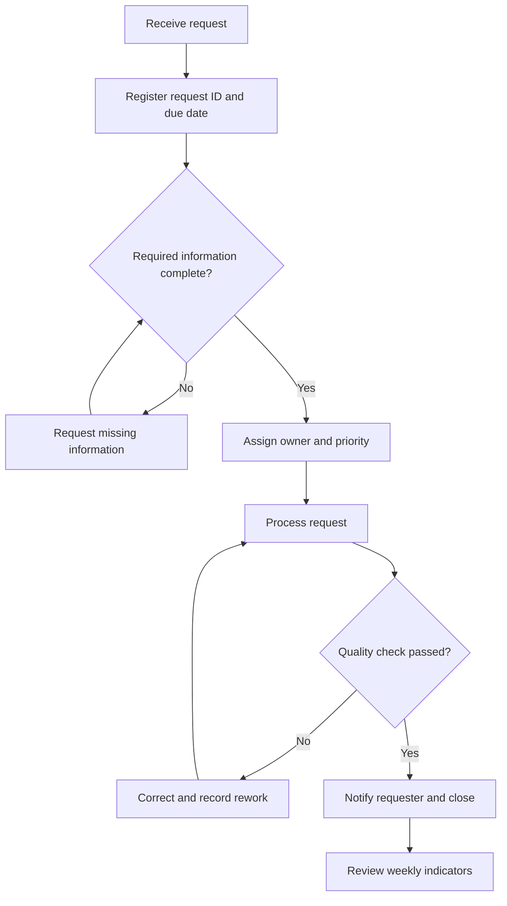

# Administrative request management — demonstration

**Independent portfolio sample | Fictional scenario | No client or patient data**

## Problem and scope

A fictional shared-services team receives internal administrative requests by email. Incomplete submissions and unclear ownership can cause rework and missed deadlines. This sample defines a repeatable intake-to-closure process. It does not report results from a real organization.

## Workflow

## Standard operating procedure

| Step | Responsible role | Action and evidence |
|---|---|---|
| 1. Intake | Intake analyst | Assign a unique ID; record receipt date, category and requested outcome. |
| 2. Validation | Intake analyst | Check required fields; record missing information and contact requester. |
| 3. Assignment | Coordinator | Assign owner and due date using the agreed priority rules. |
| 4. Processing | Assigned analyst | Complete the request; record action taken and supporting reference. |
| 5. Review | Quality reviewer | Check completeness and accuracy; record pass or return for correction. |
| 6. Closure | Assigned analyst | Notify requester; record closure date and final status. |
| 7. Monitoring | Coordinator | Review overdue items and recurring defects weekly. |

### Exception rules

- Missing information: mark as Waiting for information; retain the original receipt date.
- Overdue request: escalate to the coordinator and record the reason; do not silently change the original due date.
- Failed quality review: record the defect category and return to the owner; repeat review before closure.
- Duplicate request: link to the original ID and mark Duplicate; exclude from completion-rate calculations.

## Quality checklist

- [ ] Unique request ID and receipt date recorded.
- [ ] Required information validated.
- [ ] Owner and original due date assigned.
- [ ] Action and supporting reference documented.
- [ ] Quality review completed and defects resolved.
- [ ] Requester notified and closure date recorded.

## Measurement plan

| Indicator | Definition | Review |
|---|---|---|
| On-time closure | Closed eligible requests on or before original due date / all eligible closed requests | Weekly |
| First-pass quality | Requests passing first review / requests receiving a first review | Weekly |
| Open overdue backlog | Open eligible requests with original due date before reporting date | Weekly |
| Cycle time | Median calendar days from receipt to closure among eligible closed requests | Weekly |

Eligible requests exclude duplicates and cancellations. A zero denominator is reported as N/A, not zero percent. Waiting for information does not pause the original deadline in this sample.

## Implementation notes

Start with a shared register, assign roles, pilot the checklist, then review recurring defects and revise the procedure through a documented change process. Targets should be agreed after baseline measurement rather than presented as achieved outcomes.

This example demonstrates process mapping, standardization, quality gates and KPI definition. It is a proposed workflow, not evidence of implementation or measured improvement.
